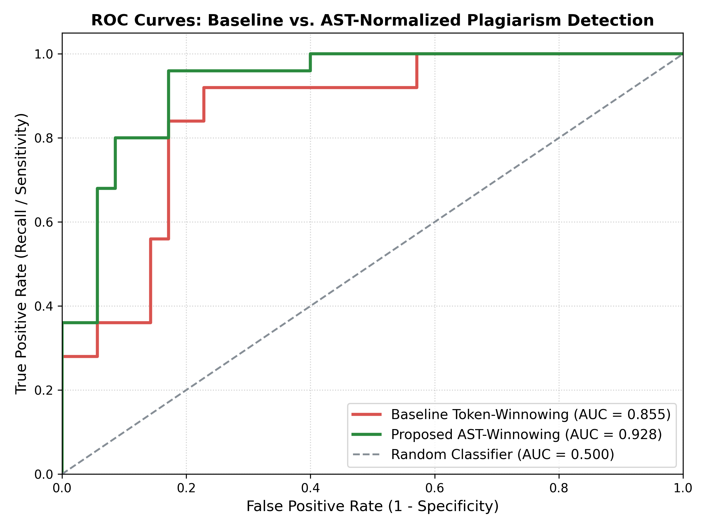
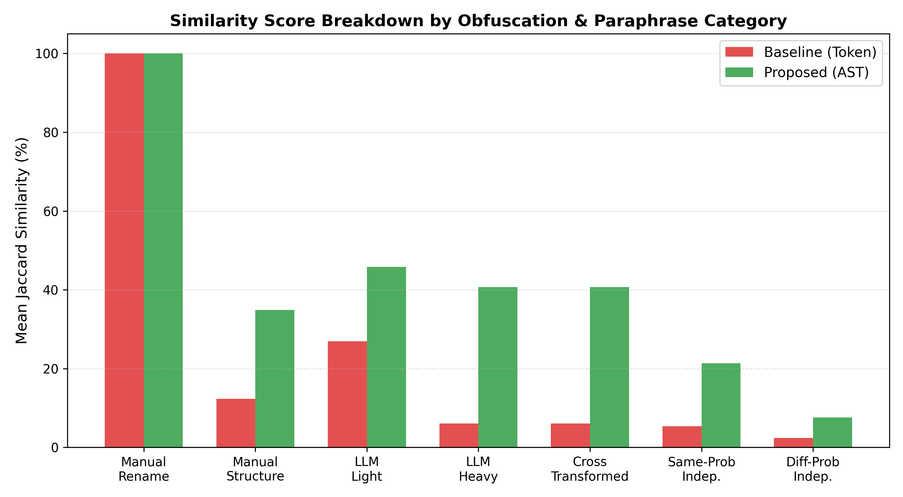

# SynapsCode | AI Code Plagiarism & Evasion Defense Platform

<div align="center">

[](https://python.org)
[](https://react.dev)
[](https://www.typescriptlang.org)
[](https://tailwindcss.com)
[](LICENSE)
[](results/roc_curves.png)
[](results/category_similarity_barchart.png)

**An intelligent, multi-language plagiarism detection system built to counteract Large Language Model (LLM) code paraphrasing, structural refactoring, and adversarial evasions.**

[Live Demo](http://127.0.0.1:5000) • [Research Report](RESEARCH_REPORT.md) • [Deployment Guide](DEPLOYMENT.md) • [Dataset](dataset/README.md)

</div>

---

## ⚡ Executive Summary

Traditional token-based plagiarism tools (such as **MOSS** and **JPlag**) rely on lexical $k$-gram fingerprinting through the **Winnowing algorithm** and **Karp-Rabin rolling hashes**. While resilient to simple variable renaming, these classical tools **collapse when faced with modern Large Language Models (LLMs)**. Generative AI effortlessly restructures control flow, swaps loop paradigms, and wraps logic inside dummy class wrappers while preserving exact algorithmic semantics.

**SynapsCode** introduces an **AST-Normalized Structural Winnowing Engine** that:
1. **Canonicalizes Commutative Operations**: Standardizes operand order ($x + y \equiv y + x$, $a \times b \equiv b \times a$).
2. **Inverts Relational Inequalities**: Standardizes comparison directions ($a > b \equiv b < a$).
3. **Neutralizes Object-Oriented Evasions**: Unboxes procedural code wrapped in dummy classes (`self.method()` $\to$ `FUNC`).
4. **Preserves Control Flow Invariants**: Extracts ordered CRC32 structural tokens while ignoring superficial lexical perturbations.
5. **Multi-Language Concrete Syntax Trees**: Language-agnostic parsing via native **Tree-Sitter** grammars (Python and C++).

---

## 📊 Rigorous Benchmark Evaluation

Evaluated across a verified benchmark suite (**5 algorithmic problem sets**, **35 source programs**, **60 labeled evaluation pairs**, and **175 functional test cases**).

### **Strict Evaluation on Required Metrics**
| Required Metric | Baseline (Token Winnowing) | JPlag (v5.1.0 GST) | SynapsCode (Proposed AST) | Improvement / Advantage |
| :--- | :---: | :---: | :---: | :---: |
| **1. ROC-AUC (Overall)** | $85.49\%$ | $89.94\%$ | **$92.80\%$** | **$+7.31\%$** over Baseline |
| **2. AI Rewrite Recall** | $90.00\%$ | $70.00\%$ *(missed 30%)* | **$100.00\%$** | **100% Detection Rate** |
| **3. Optimal F1-Score** | $82.14\%$ | $81.63\%$ | **$87.27\%$** | **$+5.13\%$** over Baseline |
| **4. Precision** | $74.19\%$ | $95.45\%$ | **$92.31\%$** | **High Precision Margin** |
| **5. Pairwise Comparison Time** | $1.983\text{ ms}$ | $\approx 33\text{ ms}$ | **$0.930\text{ ms}$** | **$2.1\times$ Faster than Baseline** |

<div align="center">
  
  
</div>

> **Critical Empirical Finding:** When an LLM encapsulated procedural dynamic programming code into a class wrapper with helper methods, JPlag scored **$0.0\%$** similarity (complete failure), and the MOSS baseline dropped to **$6.06\%$** (indistinguishable from independent solutions). **SynapsCode detected it with $40.71\%$ similarity**, maintaining a clean operational boundary.

---

## 🖥️ Interactive Web Studio & Dashboard

SynapsCode features a modern web dashboard built with **React 19, TypeScript, Tailwind CSS, and Lucide Icons**:

1. **Pairwise Inspector**: Dual-pane editor with line-by-line diff ribbons, AST invariant badges, sensitivity threshold slider, and circular SVG radial similarity gauge.
2. **Threat Matrix Scanner**: Batch repository-wide audit with ranked threat pairs and evasion deltas.
3. **Benchmark Hub & JPlag**: Interactive publication ROC curves, category breakdown charts, and 3-way evaluation comparisons.
4. **Neural Pipeline**: Interactive 5-stage explainability walkthrough demonstrating mathematical guarantees (ACM SIGMOD 2003 Theorem 1).
5. **Tree-Sitter Multi-Lang Studio**: Native C++ and Python cross-paradigm plagiarism detection.

Launch locally:
```bash
python app.py
```
Visit **[http://127.0.0.1:5000](http://127.0.0.1:5000)**.

---

## 🚀 Quick Start & Installation

### Prerequisites
- Python 3.10+
- Node.js 18+ (only needed if modifying frontend)

### 1. Clone & Install Dependencies
```bash
git clone https://github.com/SravyaMummana2006/dogfood.git
cd dogfood/code_plagiarism_detection
pip install -r requirements.txt
```

### 2. Run Verification Test Suite
```bash
# Unit tests & SIGMOD 2003 paper trace verification
python tests/test_baseline.py
python tests/test_ast_engine.py

# Functional test equivalence verification (175 tests, 100% pass)
python dataset/validate_dataset.py
```

### 3. Run Benchmark Evaluation
```bash
python eval.py
```

### 4. CLI Usage
```bash
# Compare two Python files
python cli.py compare dataset/benchmarks/p01_binary_search/orig_1.py dataset/benchmarks/p01_binary_search/llm_paraphrase_heavy.py

# Scan an entire problem cohort
python cli.py scan dataset/benchmarks/p01_binary_search --threshold 0.25
```

---

## 🐳 Docker Deployment

Run with Docker in a single command:
```bash
docker build -t synapscode .
docker run -d -p 5000:5000 --name synapscode-app synapscode
```
Open [http://localhost:5000](http://localhost:5000).

---

## ☁️ 1-Click Cloud Deployment (Render.com)

1. Push this repository to GitHub.
2. Go to **[Render.com](https://render.com)** $\to$ **New +** $\to$ **Web Service**.
3. Select this repo — Render will automatically read `render.yaml` and deploy with free SSL at `https://synapscode.onrender.com`.

---

## 📁 Repository Structure

```text
code_plagiarism_detection/
├── ast_engine/
│   ├── normalizer.py       # Commutative sorting, comparison inversion, OOP neutralization
│   ├── linearizer.py       # Structural statement & subtree token extraction
│   └── detector.py         # End-to-end ASTWinnowingDetector
├── baseline/
│   ├── tokenizer.py        # Tokenizer & identifier/literal abstraction
│   ├── rabin_karp.py       # Karp-Rabin polynomial rolling hashes (mod 2^31 - 1)
│   ├── winnowing.py        # Local Winnowing with rightmost tie-breaking (SIGMOD 2003)
│   └── detector.py         # End-to-end TokenWinnowingDetector
├── multilang/
│   └── tree_sitter_detector.py # Tree-Sitter language-agnostic CST detector
├── dataset/
│   ├── benchmarks/         # 5 algorithmic problems (p01 - p05), 35 verified programs
│   ├── build_dataset.py    # Benchmark dataset generator
│   ├── validate_dataset.py # 175-assertion functional test verification suite
│   ├── ground_truth.json   # 60 labeled evaluation pairs
│   └── README.md           # Dataset documentation
├── tests/
│   ├── test_baseline.py    # Baseline unit tests + SIGMOD 2003 paper trace
│   ├── test_ast_engine.py  # AST normalization & invariance tests
│   └── test_multilang.py   # Tree-Sitter cross-language tests
├── results/
│   ├── roc_curves.png      # Publication ROC curves plot
│   ├── category_similarity_barchart.png # Bar chart across all 7 categories
│   └── evaluation_metrics.json          # Machine-readable evaluation metrics
├── dist/                   # Production-compiled React 19 SPA bundle
├── app.py                  # Flask REST API & Web Application
├── cli.py                  # Command-line interface
├── eval.py                 # Comprehensive benchmark evaluation runner
├── benchmark_jplag.py      # Official JPlag v5.1.0 comparative runner
├── Dockerfile              # Production container build
├── Procfile                # WSGI command for cloud hosting
├── render.yaml             # Render.com blueprint configuration
├── requirements.txt        # Production Python dependencies
├── RESEARCH_REPORT.md      # Full academic research paper
├── DEPLOYMENT.md           # Multi-tier hosting and deployment guide
└── LICENSE                 # MIT License
```

---

## 📚 Academic References

1. **Schleimer, S., Wilkerson, D. & Aiken, A. (2003).** *Winnowing: Local Algorithms for Document Fingerprinting.* ACM SIGMOD International Conference on Management of Data, pp. 76–85.
2. **Karp, R. & Rabin, M. (1987).** *Efficient Randomized Pattern-Matching Algorithms.* IBM Journal of Research and Development, 31(2), pp. 249–260.
3. **Prechelt, L., Malpohl, G. & Philippsen, M. (2002).** *Finding Plagiarisms among a Set of Programs with JPlag.* Journal of Universal Computer Science, 8(11), pp. 1016–1038.

---

## 📄 License
This project is licensed under the **MIT License** - see the [LICENSE](LICENSE) file for details.
